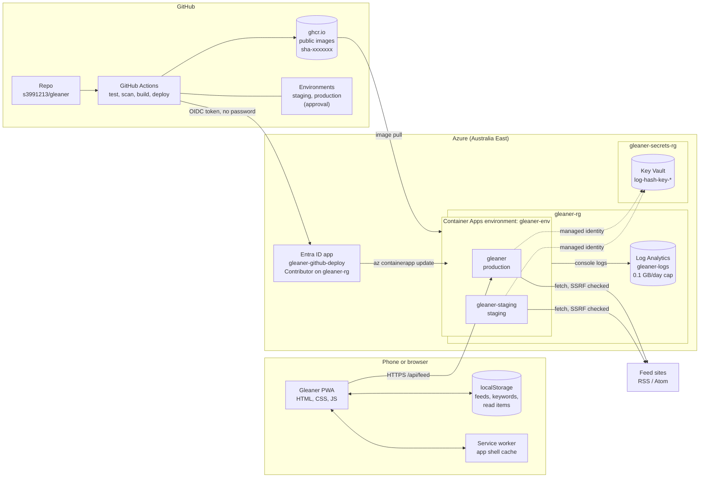

# Architecture (v1)

## Request path

1. The browser loads the app shell from the container (cached by the service worker afterwards).
2. For each enabled feed it calls `GET /api/feed?url=...` on the same origin.
3. The server validates the URL, resolves the host, refuses private and metadata addresses, fetches with limits (3 redirects, 10 s, 2 MB), parses, strips HTML and caches for 10 minutes.
4. The browser merges, sorts and highlights items. All user state stays in localStorage.

## Delivery path

1. A push to `main` runs lint, unit tests and a gitleaks secret scan. Pull requests stop here.
2. One image is built for linux/amd64, tagged `sha-<commit>` (and `latest`), with the version baked in so `/healthz` reports it.
3. That exact image deploys to **staging**, then waits for approval before **production**.
4. Each deploy records what was running, rolls out a new revision named after the version, waits until that revision is ready and `/healthz` reports the version, and rolls back automatically if it does not.
5. A production deploy publishes a GitHub release (`prod-sha-xxxxxxx`) listing the changes and how to roll back.

## Identity and secrets

| Who | Can do | How |
|---|---|---|
| GitHub Actions (staging and production environments of this repo only) | Change resources in `gleaner-rg` | OIDC federated credential, no stored password |
| `gleaner` app | Read `log-hash-key-gleaner` only | System-assigned managed identity, Key Vault Secrets User on that one secret |
| `gleaner-staging` app | Read `log-hash-key-gleaner-staging` only | Same, separate secret |
| You | Write secrets | Key Vault Secrets Officer on the vault |

The vault lives in its own resource group, so the GitHub deploy identity cannot manage it. No secret value exists in the repo, in GitHub, in container app configuration (it holds a Key Vault reference, not the value) or in logs.

## Cost controls

- Container Apps consumption plan, min replicas 0, max 2, 0.25 vCPU and 0.5 GiB per replica: inside the monthly free grant for personal use.
- Images on ghcr.io (free for public), not Azure Container Registry.
- Key Vault standard: no monthly fee, about $0.03 per 10,000 operations.
- Log Analytics: 0.1 GB/day cap, 30 day retention, inside the free 5 GB/month.
- Budget `gleaner-5-dollar-budget` on the subscription: emails at $1 actual, $5 actual and $5 forecast.
